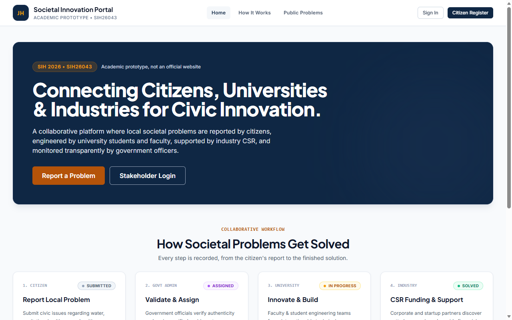
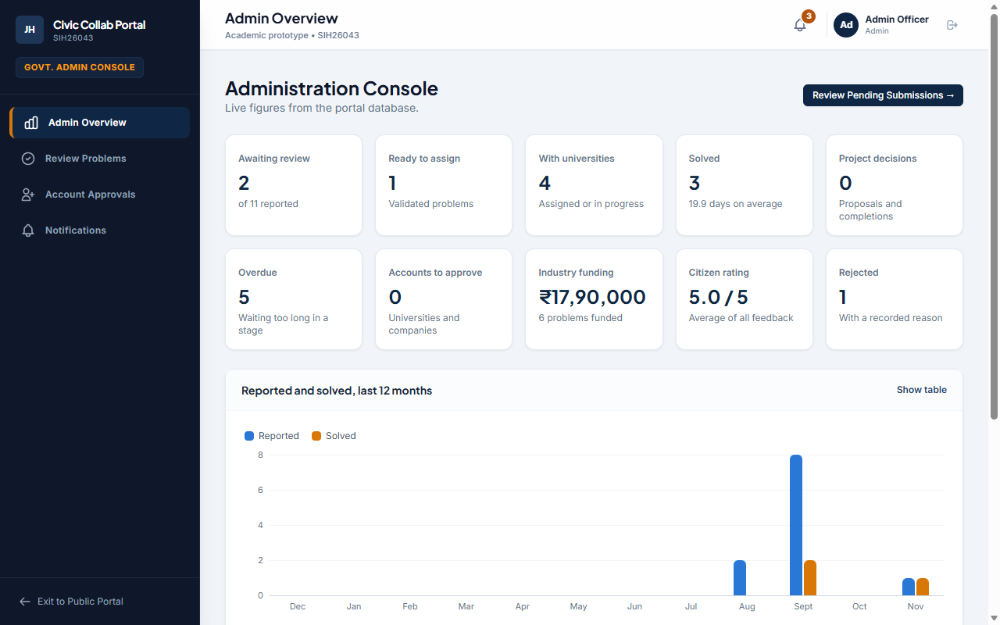
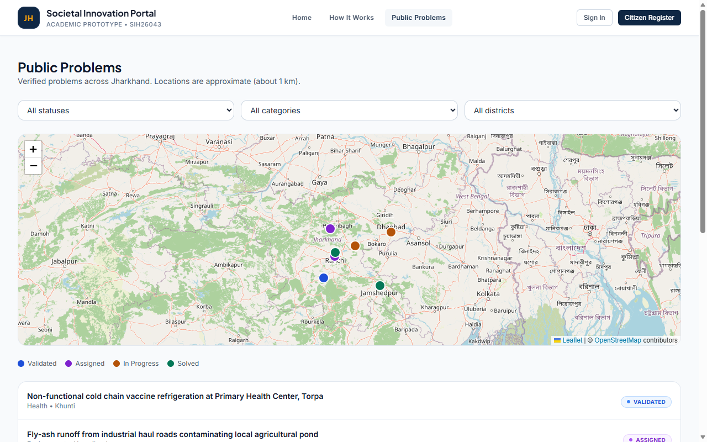
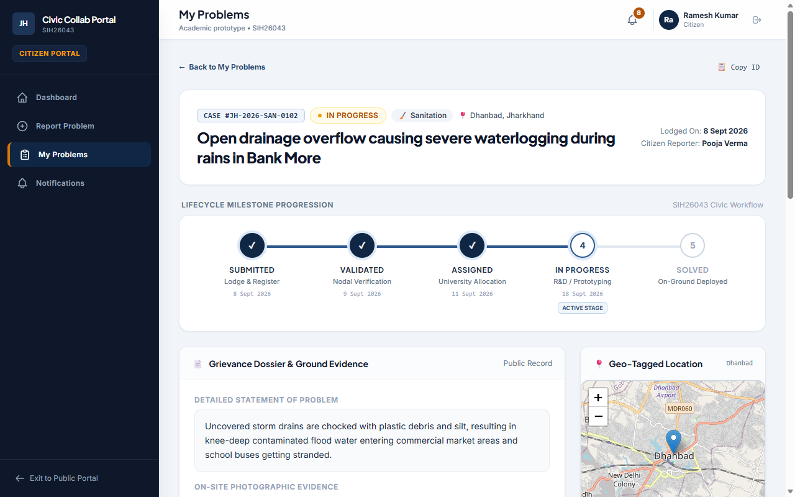
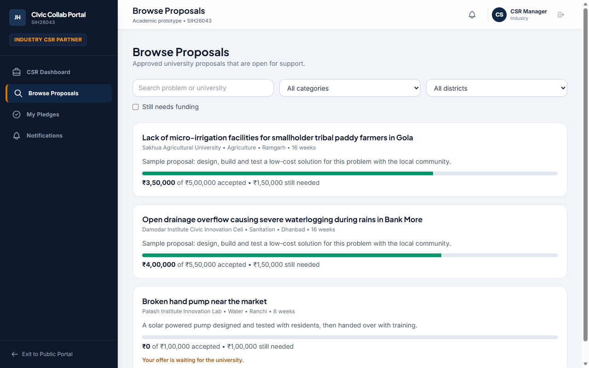

# Societal Innovation Collaboration Portal

Citizens report local problems, admins verify them, universities build solutions and industry supports them.
Built for Smart India Hackathon problem statement SIH26043 (Jharkhand).

> Student prototype. Not an official government website. Sample people and organisations are fictional.



## Features

| Role | Can do |
|---|---|
| Visitor | See verified problems on a map |
| Citizen | Report with photo and map pin, get duplicate warnings, follow progress, rate the solution |
| Admin | Verify or reject, assign, approve accounts and proposals, confirm completion, see charts and overdue cases |
| University | Accept or decline, submit a proposal with a budget, complete milestones, answer support offers |
| Industry | Browse approved proposals, offer funds, equipment or mentorship |

Everyone signed in gets in-app notifications.

| Admin dashboard | Public map |
|---|---|
|  |  |

| Problem details | Industry proposals |
|---|---|
|  |  |

## Technology

React 19, Vite 8, Tailwind CSS 3, React Router 7, React Hook Form, Zod, Leaflet · Spring Boot 4.1, Java 21, Spring
Security, JPA · MySQL 8, Flyway

## Run it

This repository is the frontend. The API is in a second repository, placed next to it as `backend`.

1. Set up and start the API: see `../backend/README.md`.
2. Here: `npm install`, then `npm run dev`.
3. Open the address it prints. With `DEMO_DATA=true`, the sign-in page fills in demo accounts with one click.

| Command | Purpose |
|---|---|
| `npm run dev` | Development server; forwards `/api` to port 8080 |
| `npm test` | Automated tests |
| `npm run lint` / `npm run build` | Check code / production build |
| `npm run format` | Format the code |

## Documents

- [Architecture, workflow and database diagrams](docs/ARCHITECTURE.md)
- [Running and deploying](docs/DEPLOYMENT.md)
- [Demo script](docs/DEMO.md)
- [Viva and interview questions](docs/VIVA.md)
- API reference: `docs/API.md` in the backend repository

## Folders

```
src/pages        one file per screen
src/components   shared pieces, grouped by role
src/services     the only code that talks to the API
src/hooks        reusable React logic
src/schemas      form rules (Zod)
src/test         screen tests; unit tests sit next to their code
```
