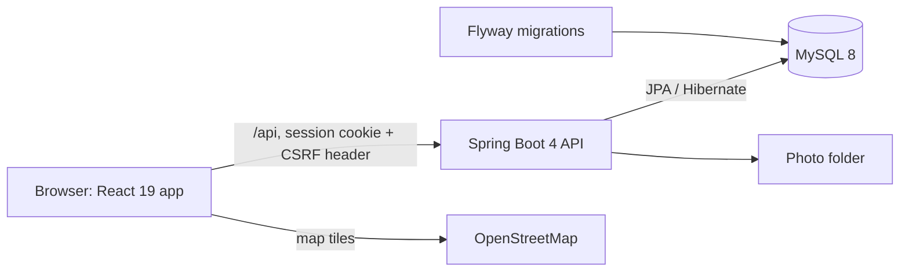
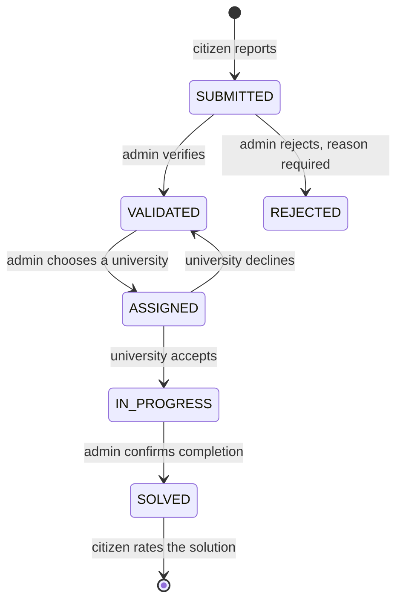
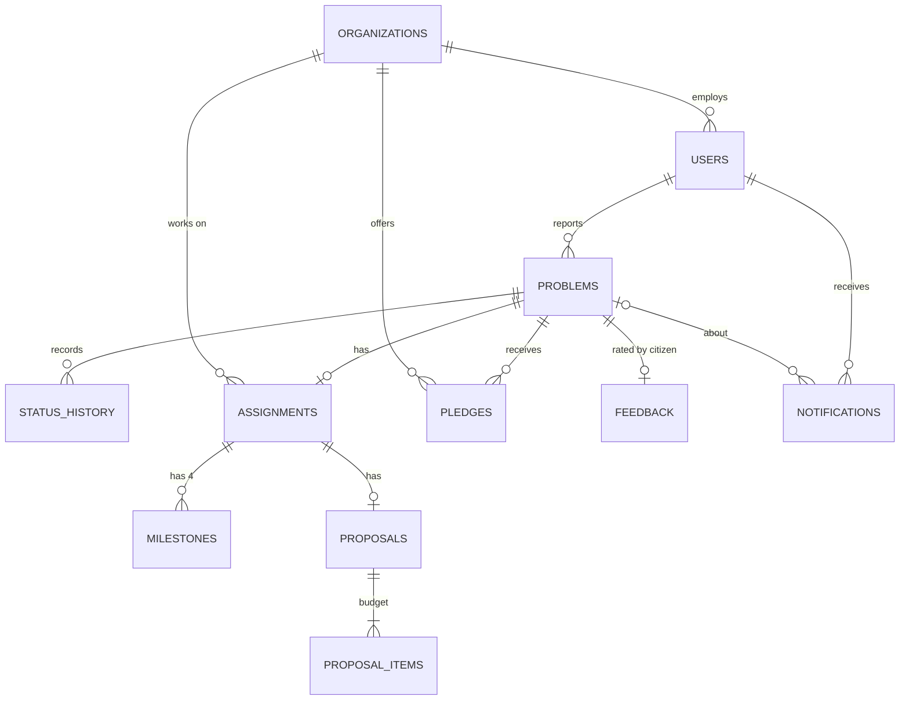
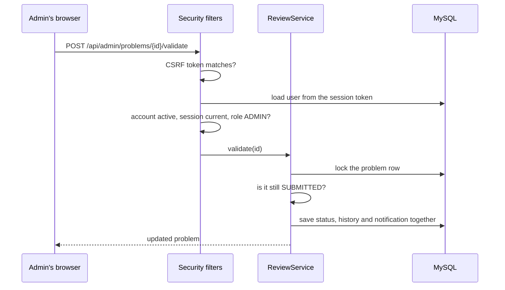

# Architecture

## Overview

The browser always talks to one origin. In development Vite forwards `/api` to the backend. In a
deployment the backend can serve the built React files itself (`FRONTEND_DIR`).

| Layer | Where | Job |
|---|---|---|
| Pages and components | `src/pages`, `src/components` | What people see |
| Services | `src/services` | The only code that calls the API |
| Controllers | `com.sip.portal.*Controller` | Read the request, check its shape |
| Services | `com.sip.portal.*Service` | Business rules and transactions |
| Repositories | `com.sip.portal.*Repository` | Database queries |

## Workflow

Inside IN_PROGRESS: the university submits a proposal, an admin approves it or asks for changes,
industry offers support, the university completes four ordered milestones and then requests
completion. Solved needs an approved proposal **and** all four milestones.

## Database

## One request, step by step

## Who can see what

| Data | Visitor | Any signed-in user | Author and admins |
|---|---|---|---|
| Verified report: title, category, status, rough location | yes | yes | yes |
| Verified report: description, photo, exact place, reporter's name | no | yes | yes |
| Unverified or rejected report | no | no | yes |

Phone numbers and emails of citizens are never included in problem data. Admins see the email of an organisation
waiting for approval.
